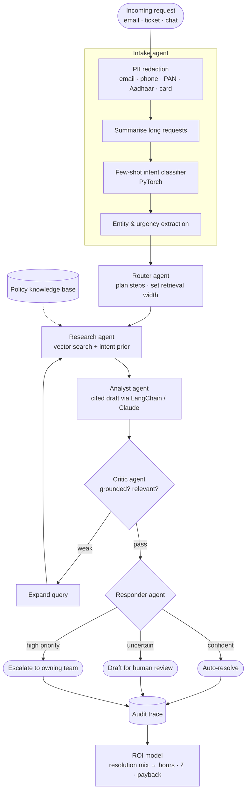

# Enterprise GenAI & Agentic Process Orchestration Suite

**Live demo → https://21cabbagee.github.io/genai-orchestration-suite/**

A multi-agent system that takes an incoming employee or customer request, cleans and classifies it, answers it from an internal knowledge base with retrieval-augmented generation (RAG), checks its own answer, and decides whether to auto-resolve, draft for a human, or escalate. It then turns the resolution mix into a business-case (ROI) estimate.

`Python` · `LangChain` · `PyTorch` · `scikit-learn` · `pydantic` · `RAG` · `Few-shot learning`

## What's inside

| Component | What it does | Where |
|---|---|---|
| **Orchestrator** | Supervised loop: intake → router → (research → analyst → critic)* → responder, with a typed shared state and a full audit trace per run | `genai_suite/orchestrator.py`, `agents/` |
| **RAG** | Section-aware chunking of markdown policies, TF-IDF features, PyTorch cosine top-k search, classifier-driven metadata prior, query expansion on retry | `genai_suite/rag/` |
| **Text processors** | PII redaction (email, phone, PAN, Aadhaar, Luhn-checked cards), entity extraction (amounts, dates, IDs), extractive summarisation, urgency detection | `genai_suite/processors/` |
| **Few-shot classifier** | PyTorch softmax layer on TF-IDF features, trained on 8 examples per intent in < 1 s | `processors/classifier.py` |
| **Critic / guardrail** | Scores grounding (is each sentence supported by evidence?) and coverage (does it address the request?) and triggers a re-retrieval when weak | `agents/specialists.py` |
| **LLM backends** | `LangChainBackend` wraps any LangChain chat model (Claude by default); `LocalExtractiveBackend` runs offline with no API key | `genai_suite/llm.py` |
| **ROI model** | Converts the observed auto-resolve / assist / escalate mix into hours saved, payback and first-year ROI | `genai_suite/roi.py` |

### Flow




## Quick start

```bash
python -m venv .venv && source .venv/bin/activate
pip install -r requirements.txt
python -m genai_suite "My expense claim is 40 days old, can I still submit it?"
pytest -q
```

To generate answers with Claude instead of the offline extractive backend:

```bash
pip install langchain-anthropic
export ANTHROPIC_API_KEY=...
python -m genai_suite "Who approves an expense claim of INR 32,000?"
```

## The browser demo

`scripts/build_demo.py` runs the Python pipeline on sample requests and exports the trained classifier weights, TF-IDF vocabulary and knowledge-base chunks to `docs/data/`. The GitHub Pages site (`docs/`) loads those files and runs the same analyzer, classifier, retrieval, critic and routing logic in JavaScript, so you can try your own requests without a backend. The browser uses the offline extractive backend; LLM generation is only available when running the Python package locally.

## Measuring ROI

Every run records how the request was resolved (auto-resolved, drafted for a human, or escalated). `genai_suite/roi.py` turns that resolution mix into handling minutes saved per request, hours saved per month, net monthly saving, payback period and first-year ROI. That makes the value of a deployment measurable from its own logs instead of estimated by hand. The demo page lets you change volume, handling time and cost assumptions live.

## Data & methodology

The suite ships with a simulated enterprise environment so it runs end to end without access to confidential systems: six policy documents (travel & expense, IT access, procurement, refunds, leave, data protection) and a labelled set of 48 support requests across six intents. To point it at a real organisation, drop its policy documents into `data/corpus/`, replace `data/tickets.csv` with labelled historical tickets, and set `ANTHROPIC_API_KEY` for LLM generation. The ROI figures in the demo are produced by the ROI model from the sample batch, using adjustable assumptions.
